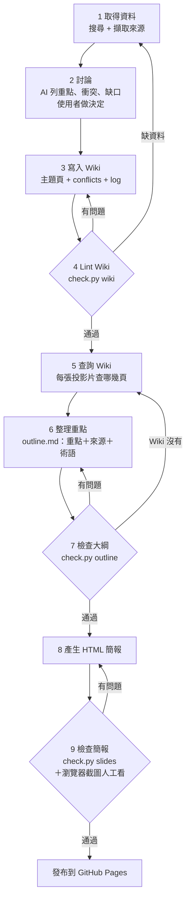

# Loop／Graph 設計：從 LLM Wiki 到教學 HTML 簡報

## 整體圖

## 各節點在做什麼

| 節點 | 輸入 → 輸出 | 誰做 |
|---|---|---|
| 1 取得資料 | 主題 → `raw/sN-*.md`（重點摘要＋網址＋等級） | AI 搜尋、擷取 |
| 2 討論 | raw 摘要 → 決定（重點、衝突怎麼處理、二手資料怎麼用） | AI 提問，**使用者決定** |
| 3 寫入 Wiki | raw＋決定 → `wiki/*.md`、`log.md` | AI |
| 4 Lint Wiki | wiki → 問題清單 | `check.py wiki`（程式） |
| 5 查詢 Wiki | 簡報主題 → 每張投影片對應的 Wiki 頁 | AI |
| 6 整理重點 | Wiki 頁 → `outline.md` | AI |
| 7 檢查大綱 | outline → 問題清單 | `check.py outline`（程式） |
| 8 產生 HTML | outline → `slides/korea-exchange/index.html` | AI |
| 9 檢查簡報 | HTML → 問題清單＋14 張截圖 | `check.py slides`＋人工看截圖 |

## 哪些步驟會重複執行？

- **3 ↔ 4**：Wiki 每次更新後都跑 lint，有問題就回去改，直到 0 個問題。
- **6 ↔ 7**：大綱沒過檢查就重寫大綱，不進到產生 HTML。
- **8 ↔ 9**：簡報沒過檢查（或截圖看到問題）就重新產生 HTML。
- **整個 1 → 4**：每多一份來源就重跑一次（先討論、後生成）。

## 哪些地方需要檢查或重新生成？

| 檢查點 | 檢查什麼 | 不通過時回到 |
|---|---|---|
| 4 Lint Wiki | 每個事實句有沒有 `[S#]`；來源存不存在；二手來源有沒有被拿來撐數字 | 3 寫入 Wiki；缺資料回 1 |
| 7 檢查大綱 | 每個重點有沒有來源；數字是否真的出現在 Wiki；術語有沒有列進術語欄 | 6 整理重點；Wiki 沒有回 5 |
| 9 檢查簡報 | 張數、每張字數、每個重點的來源標籤、數字是否在 Wiki、術語第一次出現有沒有解釋；截圖看版面與前後引用 | 8 產生 HTML |

## 為什麼這樣設計？

1. **讀者是初學者，錯一個數字就可能誤導**（例如簽證、90 天期限），所以每個事實都要能追到來源，而且用程式檢查，不靠 AI 自己說「我檢查過了」。
2. **先討論、後生成**：來源會互相矛盾（ARC 45 天 vs 6–8 週），要怎麼呈現是使用者的判斷，不應該讓 AI 自己選。
3. **檢查越前面越便宜**：Wiki 錯了，後面的大綱和簡報都會跟著錯，所以 Wiki 和大綱各有一道關卡，不只在最後檢查。
4. **程式檢查＋人工看圖並用**：程式抓得到格式和數字，抓不到「第 7 張其實是第 6 張」這種語意問題，所以最後一步保留截圖人工檢查。

---

# 反思（實際執行一次之後）

## 哪一個節點最常出錯？

**8 產生 HTML**。第一次執行時沒有給大綱節點，直接從 Wiki 寫 HTML，結果簡報檢查一次抓到 6 個問題：
- 4 個是術語沒解釋：D-2-6、ARC、NHIS 先出現在標題，下一行才解釋，對初學者來說標題就看不懂；CoA 的說明放在術語前面而不是後面。
- 2 個是缺口編號（G1）被當成不存在的來源，這是檢查腳本本身的規則漏洞。

另外，截圖人工檢查又找到兩個程式抓不到的問題：投影片之間的交叉引用寫錯張數，以及 AI 自己加了 Wiki 裡沒有的建議（清明連假）。

第二常出錯的是 **3 寫入 Wiki**：lint 抓到 3 個問題，包括在句子裡寫「S4 的表格」而沒有用 `[S4]` 標記，以及一個重點只靠二手來源 S6 支撐。

## 把檢查往前移到了哪一個步驟？

移到 **6 整理重點**。新增 `outline.md` 這個中間產物和 `check.py outline` 檢查：
- 每張投影片先列出「這張第一次出現的術語＝白話解釋」，產生 HTML 時規定標題不能先出現術語。
- 每個重點在大綱階段就要帶來源，數字要能在 Wiki 裡找到。

這樣術語和來源問題在寫 HTML 之前就會被擋下，不用等整份簡報做完再重寫。

## 有沒有因此修改 workflow／graph？為什麼？

有，改了三個地方：
1. **新增節點 6、7**（大綱＋大綱檢查），原本的圖是「查詢 Wiki → 產生 HTML → 檢查」。原因：HTML 一次產生 14 張，錯了要整份重改；大綱比較短，在這一層修比較便宜。
2. **修改檢查規則**：允許缺口編號（G1）和「待確認」、簽證代碼 D-2 不算數字。原因：規則本來就要求查不到的寫「待確認」，檢查腳本跟規則不一致，會產生誤報，讓人開始忽略檢查結果。
3. **節點 9 加入人工看截圖**。原因：交叉引用錯誤和「AI 自己加的建議」程式很難判斷，需要人看。
